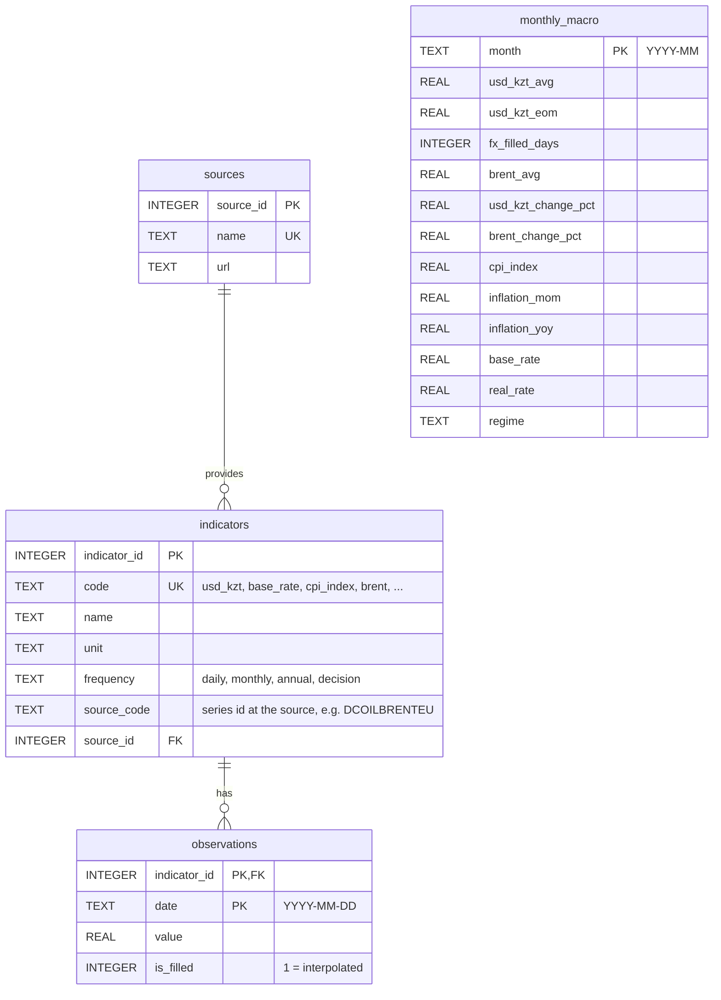

# ER diagram — `data/macro.db`

- `sources`, `indicators`, `observations` are the normalized core: every series, whatever
  its frequency, is stored as rows of `(indicator, date, value)`.
- `monthly_macro` is a derived analysis table built by `src/preprocessing.py`
  (all series aggregated to months and joined); it is used for modelling and the dashboard.
